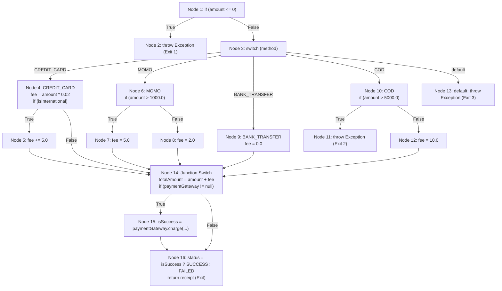

# BÁO CÁO PHÂN TÍCH CFG VÀ TÍNH ĐỘ PHỨC TẠP CHU TRÌNH MCCABE V(G)
**Học phần:** Kiểm thử phần mềm (SWT)  
**Nhiệm vụ:** Thành viên 2 – Phát triển Module 2 & 3, Thiết kế CFG và Tính toán độ phức tạp McCabe  

---

## I. TỔNG QUAN CÔNG VIỆC CỦA THÀNH VIÊN 2

Thành viên 2 chịu trách nhiệm:
1. **Phát triển Module 2 (`DiscountService.java`)**: Hiện thực hàm tính giảm giá `calculateDiscountAmount(...)` có chứa cấu trúc rẽ nhánh phức tạp và cài bẫy lỗi có chủ đích **"Implicit Else Trap"**.
2. **Phát triển Module 3 (`PaymentService.java` & `PaymentReceipt.java`)**: Hiện thực hàm xử lý thanh toán `processPayment(...)` có cấu trúc rẽ nhánh `switch-case` và các ràng buộc điều kiện biên; hỗ trợ dependency injection `PaymentGateway` cho Mockito stub/mock của Thành viên 3.
3. **Phân tích CFG 1 & Tính $V(G)_1$ cho Hàm trọng tâm số 1 (`calculateDiscountAmount`)**.
4. **Phân tích CFG 2 & Tính $V(G)_2$ cho Hàm trọng tâm số 2 (`processPayment`)**.
5. **Xác định tập đường dẫn cơ sở (Basis Paths) & Thiết kế ca kiểm thử tối thiểu** cho Statement Coverage và Decision/Branch Coverage.

---

## II. HÀM TRỌNG TÂM SỐ 1: `calculateDiscountAmount` (`DiscountService`)

### 1. Mã nguồn Java
```java
package com.group.cart.service;

public class DiscountService {
    public double calculateDiscountAmount(double subtotal, String customerTier, String couponCode, boolean isFlashSale) {
        if (subtotal <= 0) {
            return 0.0;
        }

        double discountRate = 0.0;
        if ("VIP".equals(customerTier)) {
            if (subtotal >= 1000.0) {
                discountRate = 0.15;
            } else {
                discountRate = 0.10;
            }
        } else if ("MEMBER".equals(customerTier)) {
            discountRate = 0.05;
        } else {
            discountRate = 0.0;
        }

        double totalDiscount = subtotal * discountRate;
        if ("SALE50".equals(couponCode)) {
            totalDiscount += 50.0;
        }

        // --- BẪY LỖI: IMPLICIT ELSE TRAP ---
        double maxCap = 0.0;
        if (!isFlashSale) {
            maxCap = subtotal * 0.30;
        }
        // [LỖI CỐ Ý]: Khi isFlashSale == true, nhánh else ngầm định không gán lại maxCap, 
        // dẫn đến maxCap = 0.0, làm lệnh if bên dưới ép totalDiscount về 0.0!
        if (totalDiscount > maxCap) {
            totalDiscount = maxCap;
        }

        return totalDiscount;
    }
}
```

### 2. Bảng phân rã các khối lệnh (Nodes trong CFG 1)
| Node ID | Dòng code / Khối lệnh | Kiểu Node |
| :--- | :--- | :--- |
| **Node 1** | `if (subtotal <= 0)` | Entry & Decision Node (Predicate 1) |
| **Node 2** | `return 0.0;` | Exit Node 1 |
| **Node 3** | `discountRate = 0.0; if ("VIP".equals(customerTier))` | Decision Node (Predicate 2) |
| **Node 4** | `if (subtotal >= 1000.0)` | Decision Node (Predicate 3) |
| **Node 5** | `discountRate = 0.15;` | Processing Node |
| **Node 6** | `discountRate = 0.10;` | Processing Node |
| **Node 7** | `else if ("MEMBER".equals(customerTier))` | Decision Node (Predicate 4) |
| **Node 8** | `discountRate = 0.05;` | Processing Node |
| **Node 9** | `discountRate = 0.0;` | Processing Node |
| **Node 10** | **Junction 1**: `totalDiscount = subtotal * discountRate; if ("SALE50".equals(couponCode))` | Decision Node (Predicate 5) |
| **Node 11** | `totalDiscount += 50.0;` | Processing Node |
| **Node 12** | **Junction 2**: `double maxCap = 0.0; if (!isFlashSale)` | Decision Node (Predicate 6) |
| **Node 13** | `maxCap = subtotal * 0.30;` | Processing Node |
| **Node 14** | **Junction 3 (Implicit Else)**: `if (totalDiscount > maxCap)` | Decision Node (Predicate 7) |
| **Node 15** | `totalDiscount = maxCap;` | Processing Node |
| **Node 16** | `return totalDiscount;` | Exit Node 2 |

### 3. Sơ đồ dòng điều khiển (CFG 1 Diagram)
```mermaid
flowchart TD
    N1["Node 1: if (subtotal <= 0)"]
    N2["Node 2: return 0.0 (Exit)"]
    N3["Node 3: if (customerTier == 'VIP')"]
    N4["Node 4: if (subtotal >= 1000.0)"]
    N5["Node 5: discountRate = 0.15"]
    N6["Node 6: discountRate = 0.10"]
    N7["Node 7: if (customerTier == 'MEMBER')"]
    N8["Node 8: discountRate = 0.05"]
    N9["Node 9: discountRate = 0.0"]
    N10["Node 10: Junction 1<br/>totalDiscount = subtotal * discountRate<br/>if (coupon == 'SALE50')"]
    N11["Node 11: totalDiscount += 50.0"]
    N12["Node 12: Junction 2<br/>maxCap = 0.0<br/>if (!isFlashSale)"]
    N13["Node 13: maxCap = subtotal * 0.30"]
    N14["Node 14: Junction 3 (Implicit Else Trap)<br/>if (totalDiscount > maxCap)"]
    N15["Node 15: totalDiscount = maxCap"]
    N16["Node 16: return totalDiscount (Exit)"]

    N1 -->|True| N2
    N1 -->|False| N3
    N3 -->|True| N4
    N3 -->|False| N7
    N4 -->|True| N5
    N4 -->|False| N6
    N5 --> N10
    N6 --> N10
    N7 -->|True| N8
    N7 -->|False| N9
    N8 --> N10
    N9 --> N10
    N10 -->|True| N11
    N10 -->|False| N12
    N11 --> N12
    N12 -->|True| N13
    N12 -->|False (FlashSale)| N14
    N13 --> N14
    N14 -->|True| N15
    N14 -->|False| N16
    N15 --> N16
```

### 4. Tính toán độ phức tạp chu trình McCabe $V(G)_1$

* **Phương pháp 1: Đếm nút vị từ (Predicate Nodes $P$)**
  Có 7 điểm rẽ nhánh nhị phân độc lập:
  1. $P_1$: `subtotal <= 0`
  2. $P_2$: `"VIP".equals(customerTier)`
  3. $P_3$: `subtotal >= 1000.0`
  4. $P_4$: `"MEMBER".equals(customerTier)`
  5. $P_5$: `"SALE50".equals(couponCode)`
  6. $P_6$: `!isFlashSale`
  7. $P_7$: `totalDiscount > maxCap`
  $$\mathbf{V(G)_1 = P + 1 = 7 + 1 = 8}$$

* **Phương pháp 2: Công thức $V(G) = E - N + 2$**
  * Số đỉnh (Nodes $N$): 16
  * Số cạnh (Edges $E$): 22 (gồm các cạnh rẽ nhánh và cạnh kết nối)
  $$\mathbf{V(G)_1 = 22 - 16 + 2 = 8}$$

* **Phương pháp 3: Số vùng kín trên đồ thị phẳng ($R$)**
  * Đồ thị tạo ra 7 miền kín + 1 miền vô tận bên ngoài $\rightarrow \mathbf{V(G)_1 = 8}$.

### 5. Tập 8 đường dẫn cơ sở (Basis Paths) của Hàm 1
* **Path 1**: $1 \rightarrow 2$ *(subtotal $\le 0$)*
* **Path 2**: $1 \rightarrow 3 \rightarrow 4 \rightarrow 5 \rightarrow 10 \rightarrow 11 \rightarrow 12 \rightarrow 13 \rightarrow 14 \rightarrow 15 \rightarrow 16$ *(VIP lớn, có coupon, ngày thường, vượt trần)*
* **Path 3**: $1 \rightarrow 3 \rightarrow 4 \rightarrow 6 \rightarrow 10 \rightarrow 12 \rightarrow 13 \rightarrow 14 \rightarrow 16$ *(VIP nhỏ, không coupon, ngày thường, không vượt trần)*
* **Path 4**: $1 \rightarrow 3 \rightarrow 7 \rightarrow 8 \rightarrow 10 \rightarrow 12 \rightarrow 13 \rightarrow 14 \rightarrow 16$ *(MEMBER, không coupon, ngày thường)*
* **Path 5**: $1 \rightarrow 3 \rightarrow 7 \rightarrow 9 \rightarrow 10 \rightarrow 12 \rightarrow 13 \rightarrow 14 \rightarrow 16$ *(Khách vãng lai, không coupon, ngày thường)*
* **Path 6**: $1 \rightarrow 3 \rightarrow 7 \rightarrow 9 \rightarrow 10 \rightarrow 11 \rightarrow 12 \rightarrow 13 \rightarrow 14 \rightarrow 15 \rightarrow 16$ *(Khách vãng lai, có coupon SALE50)*
* **Path 7**: $1 \rightarrow 3 \rightarrow 4 \rightarrow 5 \rightarrow 10 \rightarrow 12 \rightarrow 14 \rightarrow 15 \rightarrow 16$ *(VIP, isFlashSale = true $\rightarrow$ Kích hoạt bẫy Implicit Else)*
* **Path 8**: $1 \rightarrow 3 \rightarrow 7 \rightarrow 9 \rightarrow 10 \rightarrow 12 \rightarrow 14 \rightarrow 16$ *(Khách vãng lai, isFlashSale = true, discount = 0)*

---

## III. HÀM TRỌNG TÂM SỐ 2: `processPayment` (`PaymentService`)

### 1. Mã nguồn Java
```java
package com.group.cart.service;

import com.group.cart.model.PaymentReceipt;
import java.util.UUID;

public class PaymentService {
    private PaymentGateway paymentGateway;

    public PaymentService() {}

    public PaymentService(PaymentGateway paymentGateway) {
        this.paymentGateway = paymentGateway;
    }

    public PaymentReceipt processPayment(double amount, String paymentMethod, boolean isInternational) {
        if (amount <= 0) {
            throw new IllegalArgumentException("Payment amount must be greater than zero");
        }

        double fee = 0.0;
        String method = (paymentMethod != null) ? paymentMethod.toUpperCase() : "";

        switch (method) {
            case "CREDIT_CARD":
                fee = amount * 0.02;
                if (isInternational) {
                    fee += 5.0;
                }
                break;
            case "MOMO":
                if (amount > 1000.0) {
                    fee = 5.0;
                } else {
                    fee = 2.0;
                }
                break;
            case "BANK_TRANSFER":
                fee = 0.0;
                break;
            case "COD":
                if (amount > 5000.0) {
                    throw new IllegalArgumentException("COD is not supported for amounts over 5000");
                }
                fee = 10.0;
                break;
            default:
                throw new IllegalArgumentException("Unsupported payment method: " + paymentMethod);
        }

        double totalAmount = amount + fee;
        String transactionId = "TXN-" + UUID.randomUUID().toString().substring(0, 8);

        boolean isSuccess = true;
        if (paymentGateway != null) {
            isSuccess = paymentGateway.charge(transactionId, totalAmount);
        }

        String status = isSuccess ? "SUCCESS" : "FAILED";
        return new PaymentReceipt(transactionId, totalAmount, fee, method, status);
    }
}
```

### 2. Bảng phân rã các khối lệnh (Nodes trong CFG 2)
| Node ID | Dòng code / Khối lệnh | Kiểu Node |
| :--- | :--- | :--- |
| **Node 1** | `if (amount <= 0)` | Entry & Decision Node ($P_1$) |
| **Node 2** | `throw new IllegalArgumentException(...)` | Exit (Ngoại lệ 1) |
| **Node 3** | `switch (method)` | Đa rẽ nhánh (Multi-branch Decision) |
| **Node 4** | `case "CREDIT_CARD": fee = amount * 0.02; if (isInternational)` | Decision Node ($P_2$) |
| **Node 5** | `fee += 5.0;` | Processing Node |
| **Node 6** | `case "MOMO": if (amount > 1000.0)` | Decision Node ($P_3$) |
| **Node 7** | `fee = 5.0;` | Processing Node |
| **Node 8** | `fee = 2.0;` | Processing Node |
| **Node 9** | `case "BANK_TRANSFER": fee = 0.0;` | Processing Node |
| **Node 10** | `case "COD": if (amount > 5000.0)` | Decision Node ($P_4$) |
| **Node 11** | `throw new IllegalArgumentException("COD is not supported...")` | Exit (Ngoại lệ 2) |
| **Node 12** | `fee = 10.0;` | Processing Node |
| **Node 13** | `default: throw new IllegalArgumentException("Unsupported...")` | Exit (Ngoại lệ 3) |
| **Node 14** | **Junction Switch**: `totalAmount = amount + fee; if (paymentGateway != null)` | Decision Node ($P_5$) |
| **Node 15** | `isSuccess = paymentGateway.charge(...)` | Processing Node (Mockable) |
| **Node 16** | `status = isSuccess ? "SUCCESS" : "FAILED"; return receipt;` | Decision Node ($P_6$) & Normal Exit |

### 3. Sơ đồ dòng điều khiển (CFG 2 Diagram)


### 4. Tính toán độ phức tạp chu trình McCabe $V(G)_2$

* **Đếm số điểm rẽ nhánh (Predicate Nodes):**
  * $P_1$: `amount <= 0` (1)
  * Lệnh `switch(method)` có 5 nhánh (`CREDIT_CARD`, `MOMO`, `BANK_TRANSFER`, `COD`, `default`) tương đương **4** điểm quyết định nhị phân.
  * $P_6$: `isInternational` (trong CREDIT_CARD) (1)
  * $P_7$: `amount > 1000.0` (trong MOMO) (1)
  * $P_8$: `amount > 5000.0` (trong COD) (1)
  * $P_9$: `paymentGateway != null` (1)
  * $P_{10}$: `isSuccess ? "SUCCESS" : "FAILED"` (1)
  $$\mathbf{V(G)_2 = P + 1 = 10 + 1 = 11}$$

* **Số test case tối thiểu:** Cần tối thiểu **11 test case** để phủ kín 100% các đường dẫn cơ sở (Basis Paths) của `processPayment`.

---

## IV. BẢNG TỔNG HỢP SO SÁNH GIỮA STATEMENT VÀ DECISION COVERAGE

| Tiêu chí so sánh | Hàm 1: `calculateDiscountAmount` | Hàm 2: `processPayment` |
| :--- | :--- | :--- |
| **Số điểm vị từ $P$** | 7 | 10 |
| **Độ phức tạp $V(G)$** | **8** | **11** |
| **Số test case tối thiểu đạt 100% Statement Coverage** | **3 test cases** (chỉ cần đi qua các dòng lệnh) | **5 test cases** (chỉ cần chạy qua mỗi case) |
| **Số test case tối thiểu đạt 100% Decision Coverage** | **8 test cases** (theo đúng McCabe) | **11 test cases** (theo đúng McCabe) |
| **Khả năng bắt bẫy lỗi Implicit Else** | **100% Statement Coverage BỎ SÓT LỖI**<br/>**Decision Coverage BẮT ĐƯỢC LỖI** | Phủ đầy đủ nhánh ngoại lệ và các nhánh biên thanh toán |

---

## V. HƯỚNG DẪN BÀN GIAO CHO THÀNH VIÊN 3

1. **Về mã nguồn**:
   * [DiscountService.java](file:///c:/Users/ADMIN/Documents/GitHub/Nhom3-DeTai3-testing/src/main/java/com/group/cart/service/DiscountService.java) đã sẵn sàng.
   * [PaymentService.java](file:///c:/Users/ADMIN/Documents/GitHub/Nhom3-DeTai3-testing/src/main/java/com/group/cart/service/PaymentService.java) và [PaymentReceipt.java](file:///c:/Users/ADMIN/Documents/GitHub/Nhom3-DeTai3-testing/src/main/java/com/group/cart/model/PaymentReceipt.java), [PaymentGateway.java](file:///c:/Users/ADMIN/Documents/GitHub/Nhom3-DeTai3-testing/src/main/java/com/group/cart/service/PaymentGateway.java) đã sẵn sàng.
2. **Kịch bản kiểm thử bàn giao cho TV3**:
   * **Test Suite 1 (Statement Coverage 100% - Pass ảo)**: Thiết kế 3 test case không có `isFlashSale == true` $\rightarrow$ JaCoCo báo Statement Coverage 100%, test vẫn PASS dù có bug!
   * **Test Suite 2 (Decision Coverage - Phát hiện bug)**: Thêm test case với `isFlashSale == true` và `subtotal = 1000.0, customerTier = "VIP"` $\rightarrow$ Kết quả mong đợi là 150.0 nhưng thực tế trả về 0.0 $\rightarrow$ `AssertionFailedError` chứng minh bẫy lỗi thành công.
   * **Test Suite 3 (Mockito Integration)**: Dùng `@Mock PaymentGateway` để test nhánh `charge == true` và `charge == false` trong `PaymentIntegrationTest.java`.
