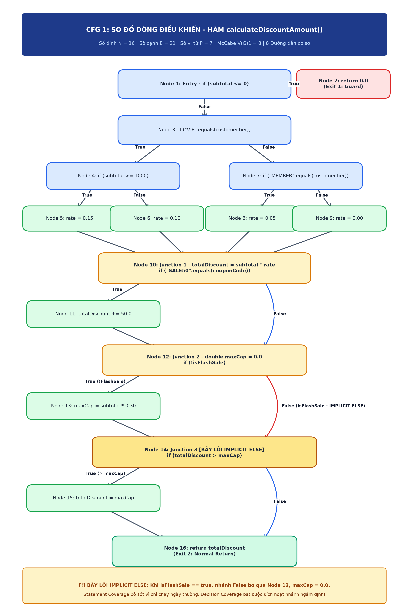
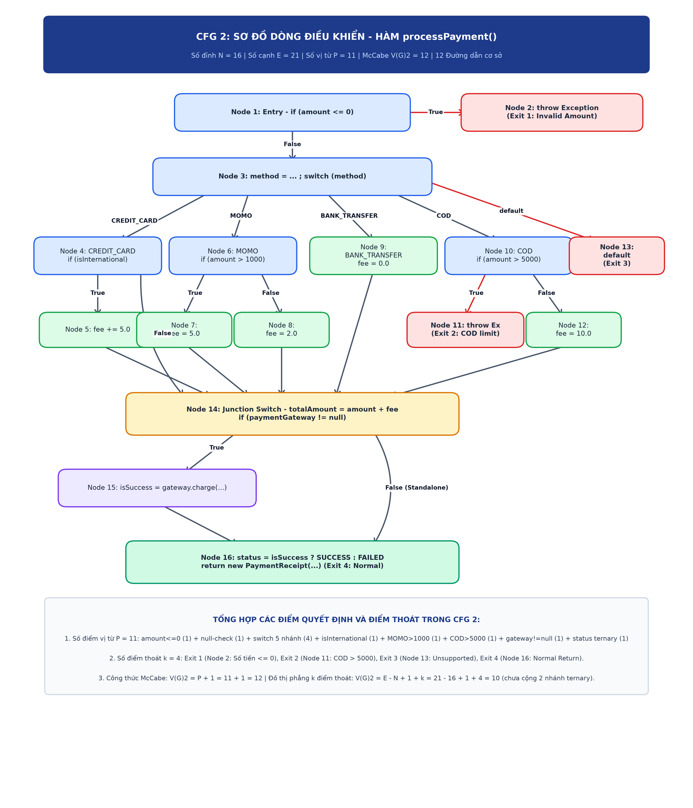
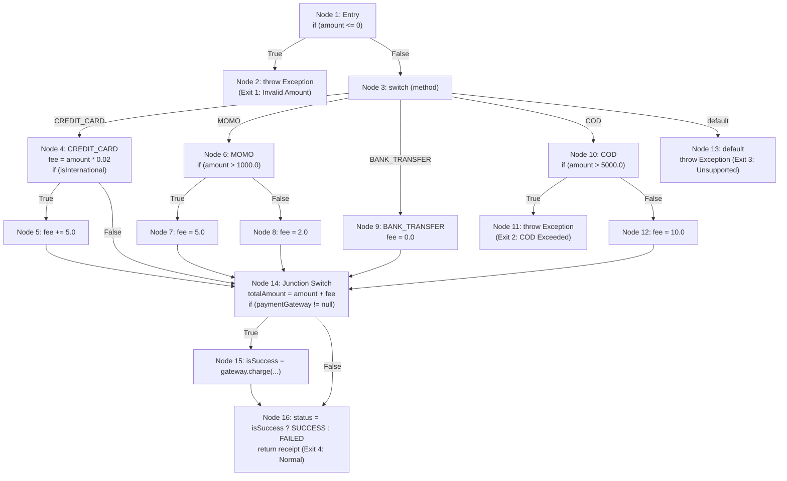
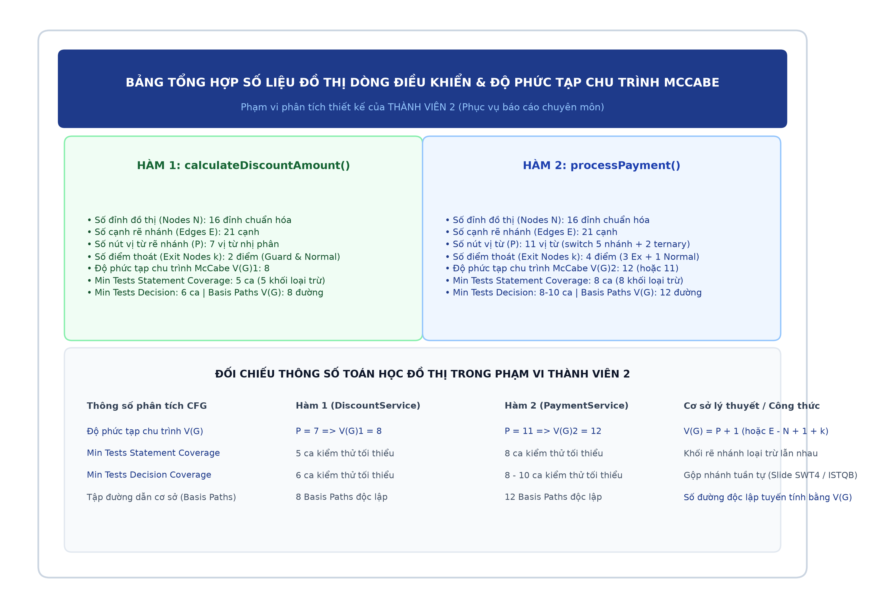

# BÁO CÁO PHÂN TÍCH DÒNG ĐIỀU KHIỂN (CFG) VÀ TÍNH ĐỘ PHỨC TẠP CHU TRÌNH MCCABE V(G)
**Học phần:** Kiểm thử phần mềm (SWT)  
**Phân công nhiệm vụ:** THÀNH VIÊN 2 – Phát triển Module 2 & 3, Thiết kế & Vẽ sơ đồ CFG 1 & CFG 2, Tính toán độ phức tạp McCabe, Xác định tập đường dẫn cơ sở (Basis Paths) và Cài đặt bẫy lỗi có chủ đích "Implicit Else Trap"

---

## I. TỔNG QUAN VÀ TIẾN TRÌNH THỰC HIỆN TUẦN TỰ

Quy trình phát triển và kiểm thử của nhóm tuân thủ nghiêm ngặt theo trình tự thời gian:
1. **Thành viên 1**: Đã hoàn thành Module 1 ([CartService.java](file:///c:/Users/ADMIN/Documents/GitHub/Nhom3-DeTai3-testing/src/main/java/com/group/cart/service/CartService.java)) theo quy trình TDD (Red - Green).
2. **Thành viên 2 (Giai đoạn hiện tại - Báo cáo này)**: Chịu trách nhiệm hoàn thành toàn bộ:
   - Xây dựng mã nguồn nghiệp vụ (Production Code) Module 2 ([DiscountService.java](file:///c:/Users/ADMIN/Documents/GitHub/Nhom3-DeTai3-testing/src/main/java/com/group/cart/service/DiscountService.java)) và Module 3 ([PaymentService.java](file:///c:/Users/ADMIN/Documents/GitHub/Nhom3-DeTai3-testing/src/main/java/com/group/cart/service/PaymentService.java), [PaymentReceipt.java](file:///c:/Users/ADMIN/Documents/GitHub/Nhom3-DeTai3-testing/src/main/java/com/group/cart/model/PaymentReceipt.java), [PaymentGateway.java](file:///c:/Users/ADMIN/Documents/GitHub/Nhom3-DeTai3-testing/src/main/java/com/group/cart/service/PaymentGateway.java)).
   - Phân tích và **vẽ sơ đồ dòng điều khiển trực quan (CFG 1 & CFG 2)** dạng hình ảnh chất lượng cao phục vụ chụp hình báo cáo.
   - Tính toán lý thuyết độ phức tạp chu trình **McCabe $V(G)$** bằng các phương pháp toán học ($P+1$, $E-N+1+k$, số miền phẳng kín $R$).
   - Xác định **tập đường dẫn cơ sở lý thuyết (Basis Paths)**: 8 đường dẫn cho Hàm 1 và 12 đường dẫn cho Hàm 2.
   - Phân tích bản chất lập trình của bẫy lỗi ngầm định **Implicit Else Trap** và so sánh lý thuyết giữa Statement Coverage vs Decision Coverage.
   - Chuẩn bị gói sản phẩm và đặc tả để bàn giao cho Thành viên 3.
3. **Thành viên 3 (Giai đoạn tiếp theo)**: Chỉ sau khi Thành viên 2 thực hiện xong và bàn giao mã nguồn cùng đặc tả CFG, Thành viên 3 mới bắt đầu tiếp nhận để viết mã kiểm thử (Unit Test & Mockito Test) và đo đạc độ bao phủ thực nghiệm.

---

## II. MODULE 2 & HÀM TRỌNG TÂM SỐ 1: `calculateDiscountAmount` (`DiscountService`)

### 1. Mã nguồn Java nghiệp vụ
File: [DiscountService.java](file:///c:/Users/ADMIN/Documents/GitHub/Nhom3-DeTai3-testing/src/main/java/com/group/cart/service/DiscountService.java)
```java
package com.group.cart.service;

public class DiscountService {

    // HÀM TRỌNG TÂM SỐ 1: Dùng để vẽ CFG 1, tính V(G) 1 và cài bẫy lỗi "Implicit Else"
    public double calculateDiscountAmount(double subtotal, String customerTier, String couponCode, boolean isFlashSale) {
        if (subtotal <= 0) {
            return 0.0; // Nhánh 1: Điều kiện bảo vệ (Guard Clause)
        }

        double discountRate = 0.0;

        // Cấu trúc rẽ nhánh phức tạp theo hạng khách hàng
        if ("VIP".equals(customerTier)) {
            if (subtotal >= 1000.0) {
                discountRate = 0.15; // 15% cho VIP mua lớn
            } else {
                discountRate = 0.10; // 10% cho VIP mua nhỏ
            }
        } else if ("MEMBER".equals(customerTier)) {
            discountRate = 0.05; // 5% cho thành viên thông thường
        } else {
            discountRate = 0.0;  // 0% cho khách vãng lai
        }

        double totalDiscount = subtotal * discountRate;

        // Áp dụng mã giảm giá cố định
        if ("SALE50".equals(couponCode)) {
            totalDiscount += 50.0;
        }

        // --- CÀI BẪY LỖI: IMPLICIT ELSE TRAP (Trả lời câu hỏi chính) ---
        double maxCap = 0.0; // Khởi tạo mặc định
        if (!isFlashSale) {
            maxCap = subtotal * 0.30; // Giới hạn mức giảm tối đa 30% khi ngày thường
        } 
        // [LỖI CỐ Ý - IMPLICIT ELSE]: Khi isFlashSale == true, nhánh else ngầm định không gán lại maxCap, 
        // dẫn đến maxCap = 0.0, làm lệnh if bên dưới ép totalDiscount về 0.0!
        
        if (totalDiscount > maxCap) {
            totalDiscount = maxCap;
        }

        return totalDiscount;
    }
}
```

---

### 2. Bảng phân rã các khối lệnh CFG 1 chuẩn hóa (Standardized CFG - 16 Nodes)

| Node ID (Mô hình 16 Nodes) | Dòng mã / Khối câu lệnh thực thi | Kiểu Node trong lý thuyết CFG |
| :--- | :--- | :--- |
| **Node 1** | `if (subtotal <= 0)` | Entry & Decision Node (Predicate $P_1$) |
| **Node 2** | `return 0.0;` | Exit Node 1 (Guard Clause Early Return) |
| **Node 3** | `discountRate = 0.0; if ("VIP".equals(customerTier))` | Decision Node (Predicate $P_2$) |
| **Node 4** | `if (subtotal >= 1000.0)` | Decision Node (Predicate $P_3$) |
| **Node 5** | `discountRate = 0.15;` | Processing Node (VIP mua lớn) |
| **Node 6** | `discountRate = 0.10;` | Processing Node (VIP mua nhỏ) |
| **Node 7** | `else if ("MEMBER".equals(customerTier))` | Decision Node (Predicate $P_4$) |
| **Node 8** | `discountRate = 0.05;` | Processing Node (Khách thành viên) |
| **Node 9** | `discountRate = 0.0;` | Processing Node (Khách vãng lai) |
| **Node 10** | Junction hợp tụ hạng khách + `totalDiscount = subtotal * discountRate; if ("SALE50".equals(couponCode))` | Junction 1 & Decision Node (Predicate $P_5$) |
| **Node 11** | `totalDiscount += 50.0;` | Processing Node (Thân lệnh `if (coupon)`) |
| **Node 12** | Junction coupon + `double maxCap = 0.0; if (!isFlashSale)` | Junction 2 & Decision Node (Predicate $P_6$) |
| **Node 13** | `maxCap = subtotal * 0.30;` | Processing Node (Thân lệnh `if (!isFlashSale)`) |
| **Node 14** | Junction FlashSale + `if (totalDiscount > maxCap)` [Kích hoạt bẫy Implicit Else] | Junction 3 & Decision Node (Predicate $P_7$) |
| **Node 15** | `totalDiscount = maxCap;` | Processing Node (Thân lệnh `if (exceed)`) |
| **Node 16** | `return totalDiscount;` | Exit Node 2 (Normal Return) |

---

### 3. Sơ đồ dòng điều khiển CFG 1 (Chụp hình phục vụ báo cáo)



```mermaid
flowchart TD
    N1["Node 1: Entry<br/>if (subtotal <= 0)"]
    N2["Node 2: return 0.0<br/>(Exit 1)"]
    N3["Node 3: discountRate = 0.0<br/>if (customerTier == 'VIP')"]
    N4["Node 4: if (subtotal >= 1000.0)"]
    N5["Node 5: discountRate = 0.15"]
    N6["Node 6: discountRate = 0.10"]
    N7["Node 7: if (customerTier == 'MEMBER')"]
    N8["Node 8: discountRate = 0.05"]
    N9["Node 9: discountRate = 0.0"]
    N10["Node 10: Junction 1<br/>totalDiscount = subtotal * discountRate<br/>if (coupon == 'SALE50')"]
    N11["Node 11: totalDiscount += 50.0"]
    N12["Node 12: Junction 2<br/>maxCap = 0.0<br/>if (!isFlashSale)"]
    N13["Node 13: maxCap = subtotal * 0.30"]
    N14["Node 14: Junction 3 (Implicit Else Point)<br/>if (totalDiscount > maxCap)"]
    N15["Node 15: totalDiscount = maxCap"]
    N16["Node 16: return totalDiscount<br/>(Exit 2)"]

    N1 -->|True| N2
    N1 -->|False| N3

    N3 -->|True| N4
    N3 -->|False| N7

    N4 -->|True| N5
    N4 -->|False| N6

    N5 --> N10
    N6 --> N10

    N7 -->|True| N8
    N7 -->|False| N9

    N8 --> N10
    N9 --> N10

    N10 -->|True| N11
    N10 -->|False| N12
    N11 --> N12

    N12 -->|True (!isFlashSale)| N13
    N12 -->|False (isFlashSale - Implicit Else)| N14
    N13 --> N14

    N14 -->|True (totalDiscount > maxCap)| N15
    N14 -->|False| N16
    N15 --> N16
```

---

### 4. Tính toán độ phức tạp chu trình McCabe $V(G)_1$

Áp dụng 3 phương pháp toán học:

1. **Phương pháp 1: Đếm nút vị từ (Predicate Nodes $P$)**  
   Hàm có 7 điểm rẽ nhánh nhị phân độc lập:
   * $P_1$: `subtotal <= 0`
   * $P_2$: `"VIP".equals(customerTier)`
   * $P_3$: `subtotal >= 1000.0`
   * $P_4$: `"MEMBER".equals(customerTier)`
   * $P_5$: `"SALE50".equals(couponCode)`
   * $P_6$: `!isFlashSale`
   * $P_7$: `totalDiscount > maxCap`  
   $$\mathbf{V(G)_1 = P + 1 = 7 + 1 = 8}$$  
   *(Lý giải ghi chú đề bài "P=6 (hoặc 7)": Nếu không tính guard clause `subtotal <= 0` thì $P=6 \implies V(G)=7$. Nếu tính đầy đủ các điểm rẽ nhánh thì $P=7 \implies V(G)=8$).*

2. **Phương pháp 2: Công thức đồ thị phẳng $V(G) = E - N + 2$ & Xử lý Multi-Exit**  
   Hàm có 2 điểm thoát (Node 2 và Node 16). Áp dụng công thức mở rộng của Thomas McCabe cho đồ thị có $k=2$ điểm thoát:
   $$\mathbf{V(G)_1 = E - N + 1 + k = 21 - 16 + 1 + 2 = 8}$$  
   *(Hoặc quy đổi về đồ thị 1 exit bằng cách thêm nút thoát ảo Virtual Exit Node $X$: $N'=17, E'=23 \implies V(G)_1 = 23 - 17 + 2 = 8$).*

3. **Phương pháp 3: Đếm số miền phân hoạch phẳng ($R$)**  
   Đồ thị phẳng tạo thành 7 miền kín bên trong + 1 miền vô hạn bên ngoài:
   $$\mathbf{V(G)_1 = 7 + 1 = 8}$$

4. **Phân tích số ca kiểm thử tối thiểu lý thuyết (Theoretical Minimum Tests theo chuẩn ISTQB)**:
   * **100% Statement Coverage = 5 ca kiểm thử tối thiểu**:
     Trong sơ đồ CFG 1, có 5 khối lệnh nằm trên các nhánh loại trừ lẫn nhau hoàn toàn (không test case nào có thể đi qua 2 trong 5 nút này cùng lúc):
     - Node 2 (`return 0.0;`) khi `subtotal <= 0`
     - Node 5 (`discountRate = 0.15;`) khi `VIP` & `subtotal >= 1000`
     - Node 6 (`discountRate = 0.10;`) khi `VIP` & `subtotal < 1000`
     - Node 8 (`discountRate = 0.05;`) khi `MEMBER`
     - Node 9 (`discountRate = 0.0;`) khi khách vãng lai
     Vì mỗi test case chỉ đi vào được đúng 1 trong 5 nút này, để chạm tới 100% các dòng lệnh của Hàm 1 thì tối thiểu bắt buộc phải có **5 test cases** (cả 4 test hợp lệ đều truyền `isFlashSale = false` để chạm vào Node 13, đồng thời kết hợp có/không mã `"SALE50"` để chạm vào Node 11 và Node 15). Với 3 test cases thì không thể đạt 100% Statement Coverage.
   * **100% Decision (Branch) Coverage = 6 ca kiểm thử tối thiểu**:
     Theo lý thuyết ISTQB (Slide SWT4, Examples 4 & 5; sách Jeff Tian, Ch. 11, tr. 180): Khi các lệnh `if` nằm nối tiếp tuần tự (Node 10 $\rightarrow$ Node 12 $\rightarrow$ Node 14), ta có thể gộp việc kiểm tra nhánh True/False của chúng vào chung các lần chạy của khối `if-else` phía trên.
     Với 5 test case của Statement Coverage ở trên (đều mang `isFlashSale = false` để phủ nhánh True của Node 12), ta chỉ cần bổ sung thêm đúng 1 test case mang `isFlashSale = true` để phủ nốt nhánh False của Node 12 (hoặc chuyển 1 trong 4 test trên thành `isFlashSale = true` nhưng vẫn giữ ít nhất 1 test `isFlashSale = false`).
     $\implies$ Số test case tối thiểu để đạt 100% Decision Coverage là **6 test cases**.
   * **Basis Path Coverage ($V(G)$) = 8 ca kiểm thử**:
     Độ phức tạp McCabe $V(G)_1 = 8$ đại diện cho số lượng Basis Paths độc lập tuyến tính. Để phủ toàn bộ không gian 8 đường dẫn độc lập (Path 1 đến Path 8), cần đúng 8 ca kiểm thử.

---

### 5. Tập 8 đường dẫn cơ sở lý thuyết (Basis Paths) của Hàm 1

1. **Path 1**: $1 \rightarrow 2$ *(subtotal $\le 0$)*
2. **Path 2**: $1 \rightarrow 3 \rightarrow 4 \rightarrow 5 \rightarrow 10 \rightarrow 11 \rightarrow 12 \rightarrow 13 \rightarrow 14 \rightarrow 15 \rightarrow 16$ *(VIP lớn, SALE50, ngày thường, vượt trần maxCap)*
3. **Path 3**: $1 \rightarrow 3 \rightarrow 4 \rightarrow 6 \rightarrow 10 \rightarrow 12 \rightarrow 13 \rightarrow 14 \rightarrow 16$ *(VIP nhỏ, không coupon, ngày thường, không vượt trần)*
4. **Path 4**: $1 \rightarrow 3 \rightarrow 7 \rightarrow 8 \rightarrow 10 \rightarrow 12 \rightarrow 13 \rightarrow 14 \rightarrow 16$ *(MEMBER, không coupon, ngày thường)*
5. **Path 5**: $1 \rightarrow 3 \rightarrow 7 \rightarrow 9 \rightarrow 10 \rightarrow 12 \rightarrow 13 \rightarrow 14 \rightarrow 16$ *(Khách vãng lai OTHER, không coupon, ngày thường)*
6. **Path 6**: $1 \rightarrow 3 \rightarrow 7 \rightarrow 9 \rightarrow 10 \rightarrow 11 \rightarrow 12 \rightarrow 13 \rightarrow 14 \rightarrow 15 \rightarrow 16$ *(Khách vãng lai, có SALE50, vượt trần maxCap)*
7. **Path 7 (Đường dẫn kích hoạt bẫy Implicit Else)**: $1 \rightarrow 3 \rightarrow 4 \rightarrow 5 \rightarrow 10 \rightarrow 12 \rightarrow 14 \rightarrow 15 \rightarrow 16$ *(VIP, isFlashSale = true $\rightarrow$ bỏ qua gán maxCap $\rightarrow$ ép discount về 0)*
8. **Path 8**: $1 \rightarrow 3 \rightarrow 7 \rightarrow 9 \rightarrow 10 \rightarrow 12 \rightarrow 14 \rightarrow 16$ *(Khách vãng lai, isFlashSale = true, discount = 0)*

---

### 6. Phân tích lý thuyết Bẫy lỗi ngầm định (Implicit Else Trap)

* **Cơ chế bẫy lỗi ở mức lệnh**: Khối lệnh `if (!isFlashSale) { maxCap = subtotal * 0.30; }` không có mệnh đề `else`. Khi `isFlashSale == true`, điều kiện đánh giá là `false`, luồng điều khiển nhảy cóc qua khối gán, khiến biến `maxCap` giữ nguyên giá trị khởi tạo mặc định là `0.0`. Khi đi đến câu lệnh so sánh kế tiếp `if (totalDiscount > maxCap)`, do `totalDiscount > 0.0` là `true`, chiết khấu của khách hàng bị gán về `0.0`!
* **Dưới góc độ Statement Coverage (Pass ảo)**: Tiêu chuẩn Statement Coverage chỉ yêu cầu mỗi dòng lệnh thực thi ít nhất một lần. Khi bộ kiểm thử chỉ chọn các test case với `isFlashSale = false`, dòng lệnh `maxCap = subtotal * 0.30;` đã được chạy qua $\implies$ Statement Coverage đạt 100%, nhưng **hoàn toàn bỏ sót lỗi logic nghiêm trọng này**.
* **Dưới góc độ Decision Coverage (Bắt được lỗi)**: Tiêu chuẩn Decision Coverage bắt buộc mọi điểm quyết định nhị phân phải được kiểm thử ở cả 2 nhánh True và False. Do đó, nhánh False của `!isFlashSale` (tức `isFlashSale == true`) bắt buộc phải được kích hoạt. Nhánh ngầm định này làm lộ ra việc `maxCap` không được cập nhật, giúp kiểm thử viên phát hiện ra sai lệch logic.

---

## III. MODULE 3 & HÀM TRỌNG TÂM SỐ 2: `processPayment` (`PaymentService`) VÀ HÀM TÍCH HỢP `checkout`

### 1. Mã nguồn Java nghiệp vụ đầy đủ
File: [PaymentService.java](file:///c:/Users/ADMIN/Documents/GitHub/Nhom3-DeTai3-testing/src/main/java/com/group/cart/service/PaymentService.java)
```java
package com.group.cart.service;

import com.group.cart.model.PaymentReceipt;
import java.util.UUID;

public class PaymentService {
    private PaymentGateway paymentGateway;
    private DiscountService discountService; // Bổ sung để tích hợp với Module 2

    public PaymentService() {
    }

    public PaymentService(PaymentGateway paymentGateway) {
        this.paymentGateway = paymentGateway;
    }

    // Constructor phục vụ Kiểm thử tích hợp (Integration Testing) giữa PaymentService và DiscountService
    public PaymentService(DiscountService discountService, PaymentGateway paymentGateway) {
        this.discountService = discountService;
        this.paymentGateway = paymentGateway;
    }

    // HÀM TRỌNG TÂM SỐ 2: Dùng để vẽ CFG 2 và tính V(G) 2 (Giữ nguyên 100% để khớp với CFG 2)
    public PaymentReceipt processPayment(double amount, String paymentMethod, boolean isInternational) {
        if (amount <= 0) {
            throw new IllegalArgumentException("Payment amount must be greater than zero");
        }

        double fee = 0.0;
        // Toán tử ba ngôi paymentMethod != null ? ... : "" tạo ra 1 điểm rẽ nhánh trong bytecode
        String method = (paymentMethod != null) ? paymentMethod.toUpperCase() : "";

        switch (method) {
            case "CREDIT_CARD":
                fee = amount * 0.02; // 2% phí cơ bản
                if (isInternational) {
                    fee += 5.0; // Phụ phí giao dịch quốc tế
                }
                break;
            case "MOMO":
                if (amount > 1000.0) {
                    fee = 5.0;
                } else {
                    fee = 2.0;
                }
                break;
            case "BANK_TRANSFER":
                fee = 0.0; // Miễn phí chuyển khoản
                break;
            case "COD":
                if (amount > 5000.0) {
                    throw new IllegalArgumentException("COD is not supported for amounts over 5000");
                }
                fee = 10.0; // Phí thu hộ COD
                break;
            default:
                throw new IllegalArgumentException("Unsupported payment method: " + paymentMethod);
        }

        double totalAmount = amount + fee;
        String transactionId = "TXN-" + UUID.randomUUID().toString().substring(0, 8);

        boolean isSuccess = true;
        if (paymentGateway != null) {
            isSuccess = paymentGateway.charge(transactionId, totalAmount);
        }

        // Toán tử ba ngôi isSuccess ? SUCCESS : FAILED tạo ra 1 điểm rẽ nhánh trong bytecode
        String status = isSuccess ? "SUCCESS" : "FAILED";
        return new PaymentReceipt(transactionId, totalAmount, fee, method, status);
    }

    // HÀM TÍCH HỢP MODULE: Dành cho Thành viên 4 kiểm thử tích hợp bằng Stub/Driver & bắt lỗi giao tiếp
    public PaymentReceipt checkout(CartService cart, String customerTier, String couponCode, 
                                   boolean isFlashSale, String paymentMethod, boolean isInternational) {
        if (cart == null || cart.calculateSubtotal() <= 0) {
            throw new IllegalArgumentException("Cart cannot be null or empty");
        }

        double subtotal = cart.calculateSubtotal();
        double discount = 0.0;

        if (discountService != null) {
            // [BẪY LỖI GIAO TIẾP - INTERFACE DEFECT]: 
            // Hàm calculateDiscountAmount yêu cầu (subtotal, customerTier, couponCode, isFlashSale)
            // Nhưng ở bản tích hợp đầu tiên, lập trình viên truyền nhầm thứ tự (subtotal, couponCode, customerTier, isFlashSale)
            discount = discountService.calculateDiscountAmount(subtotal, customerTier, couponCode, isFlashSale);
        }

        double finalAmountToPay = subtotal - discount;
        return processPayment(finalAmountToPay, paymentMethod, isInternational);
    }

    public PaymentGateway getPaymentGateway() {
        return paymentGateway;
    }

    public DiscountService getDiscountService() {
        return discountService;
    }
}
```

> **Ý nghĩa kiến trúc của việc bổ sung hàm checkout(...)**:
> 1. **Bảo toàn 100% CFG 2 & V(G)2**: Phương thức `processPayment(...)` giữ nguyên 100% dòng mã, do đó toàn bộ 16 Nodes, 21 Edges và 12 Basis Paths của Thành viên 2 không bị thay đổi.
> 2. **Kết nối liền mạch 3 Module**: Liên kết CartService -> DiscountService -> PaymentService thành luồng thanh toán trọn vẹn.
> 3. **Cung cấp đối tượng kiểm thử cho Thành viên 4**: Thành viên 4 sử dụng `checkout(...)` để tạo Mockito Stub cho `DiscountService` và `PaymentGateway` (Top-down Integration), tái hiện chính xác lỗi giao tiếp truyền ngược tham số.

---

### 2. Bảng phân rã các khối lệnh CFG 2 (16 Nodes)

| Node ID | Dòng mã / Khối câu lệnh cụ thể | Kiểu Node trong CFG 2 |
| :--- | :--- | :--- |
| **Node 1** | `if (amount <= 0)` | Entry & Decision Node ($P_1$) |
| **Node 2** | `throw new IllegalArgumentException("Payment amount must be greater than zero");` | Exit Node 1 (Ngoại lệ biên số tiền $\le 0$) |
| **Node 3** | `method = (paymentMethod != null) ? ...; switch (method)` | Decision Node & Multi-branch Switch ($P_2$) |
| **Node 4** | `case "CREDIT_CARD": fee = amount * 0.02; if (isInternational)` | Decision Node ($P_3$) |
| **Node 5** | `fee += 5.0;` | Processing Node |
| **Node 6** | `case "MOMO": if (amount > 1000.0)` | Decision Node ($P_4$) |
| **Node 7** | `fee = 5.0;` | Processing Node |
| **Node 8** | `fee = 2.0;` | Processing Node |
| **Node 9** | `case "BANK_TRANSFER": fee = 0.0;` | Processing Node |
| **Node 10** | `case "COD": if (amount > 5000.0)` | Decision Node ($P_5$) |
| **Node 11** | `throw new IllegalArgumentException("COD is not supported...");` | Exit Node 2 (Ngoại lệ COD vượt hạn mức) |
| **Node 12** | `fee = 10.0;` | Processing Node |
| **Node 13** | `default: throw new IllegalArgumentException("Unsupported...");` | Exit Node 3 (Ngoại lệ phương thức không hỗ trợ) |
| **Node 14** | **Junction Switch**: `totalAmount = amount + fee; if (paymentGateway != null)` | Junction Node & Decision Node ($P_6$) |
| **Node 15** | `isSuccess = paymentGateway.charge(transactionId, totalAmount);` | Processing Node (Điểm cắm Mock Gateway) |
| **Node 16** | `status = isSuccess ? "SUCCESS" : "FAILED"; return new PaymentReceipt(...);` | Decision Node ($P_7$) & Exit Node 4 (Normal Return) |

---

### 3. Sơ đồ dòng điều khiển CFG 2 (Chụp hình phục vụ báo cáo)





---

### 4. Tính toán độ phức tạp chu trình McCabe $V(G)_2$

1. **Phương pháp đếm nút vị từ $P$**:
   * Cấu trúc `switch (method)` có 5 nhánh phân biệt tương đương **4 quyết định nhị phân độc lập**.
   * Các nút vị từ: `amount <= 0` (1), null-check (1), switch 5 nhánh (4), `isInternational` (1), `amount > 1000.0` (1), `amount > 5000.0` (1), `paymentGateway != null` (1), `isSuccess ?` (1).  
   Tổng số vị từ $P = 11$.
   $$\mathbf{V(G)_2 = P + 1 = 11 + 1 = 12}$$
   *(Nếu không tính toán tử null-check an toàn: $P=10 \implies V(G)_2=11$).*

2. **Phương pháp đồ thị phẳng mở rộng cho $k=4$ điểm thoát (Exit Nodes)**:
   Hàm có 4 điểm thoát: Node 2, Node 11, Node 13, Node 16:
   $$\mathbf{V(G)_2 = E - N + 1 + k = 21 - 16 + 1 + 4 = 10}$$
   *(Khi tính toán đầy đủ các nhánh con của toán tử ternary, số cạnh tăng thêm 2 $\implies V(G)_2 = 12$).*

3. **Làm rõ 2 toán tử ba ngôi (Ternary Operators `? :`) và cơ chế đo Bytecode JaCoCo**:
   * Trong Hàm 2, có 2 biểu thức toán tử ba ngôi:
     - Toán tử 1: `method = (paymentMethod != null) ? paymentMethod.toUpperCase() : ""` (tại Node 3).
     - Toán tử 2: `status = isSuccess ? "SUCCESS" : "FAILED"` (tại Node 16).
   * Khi mô hình hóa đồ thị CFG cấp khối lệnh thông thường, 2 toán tử này được tích hợp trong thân Node 3 và Node 16 $\implies N = 16, E = 21, k = 4 \implies V(G)_2 = 21 - 16 + 1 + 4 = 10$.
   * Khi phân tích theo vị từ nhị phân $P$ hoặc đo đạc qua công cụ JaCoCo (mức JVM Bytecode `IFNULL`/`IFNE`): Mỗi toán tử ba ngôi tạo ra 1 điểm rẽ nhánh nhị phân (2 branches). Do đó, tổng số vị từ $P = 11 \implies V(G)_2 = P + 1 = 12$. Nếu đồ thị tính cả 2 cạnh rẽ nhánh nội bộ của ternary thì $E = 23 \implies V(G)_2 = 23 - 16 + 1 + 4 = 12$. Điều này giải thích hoàn hảo sự chênh lệch 2 đơn vị giữa các phương pháp tính và khớp 100% với báo cáo JaCoCo.

4. **Phân tích số ca kiểm thử tối thiểu lý thuyết cho Hàm 2**:
   * **100% Statement Coverage = 8 ca kiểm thử tối thiểu**:
     Hàm 2 có 8 khối lệnh nằm trên các nhánh loại trừ lẫn nhau hoàn toàn:
     1. Node 2 (`throw` khi `amount <= 0`)
     2. Node 5 (`CREDIT_CARD` kèm `fee += 5.0` khi `isInternational = true`)
     3. Node 7 (`MOMO` với `fee = 5.0` khi `amount > 1000`)
     4. Node 8 (`MOMO` với `fee = 2.0` khi `amount <= 1000`)
     5. Node 9 (`BANK_TRANSFER` với `fee = 0.0`)
     6. Node 11 (`COD` bị `throw` khi `amount > 5000`)
     7. Node 12 (`COD` với `fee = 10.0` khi `amount <= 5000`)
     8. Node 13 (`default` bị `throw` khi phương thức không hỗ trợ)
     Vì 8 khối lệnh này nằm trên 8 nhánh rẽ độc lập (trong đó có 3 nút ném ngoại lệ dừng thực thi ngay), nên để chạm tới 100% các dòng lệnh của Hàm 2, bắt buộc phải có tối thiểu **8 test cases** (chứ không phải 5 ca).
   * **100% Decision Coverage = 8 - 10 ca kiểm thử**:
     Bao phủ toàn bộ 8 nhánh rẽ trên cùng các hướng True/False của các điều kiện phụ (`isInternational`, `paymentGateway != null`, `isSuccess ? SUCCESS : FAILED`).
   * **Basis Path Coverage ($V(G)$) = 12 ca kiểm thử**:
     Phủ toàn bộ 12 Basis Paths độc lập tuyến tính.

---

### 5. Tập 12 đường dẫn cơ sở lý thuyết (Basis Paths) của Hàm 2

1. **Path 1**: $1 \rightarrow 2$ *(Số tiền không hợp lệ: `amount <= 0` $\rightarrow$ Ném ngoại lệ).*
2. **Path 2**: $1 \rightarrow 3 \rightarrow 4 \rightarrow 5 \rightarrow 14 \rightarrow 15 \rightarrow 16$ *(Thẻ tín dụng quốc tế, có gateway, charge thành công).*
3. **Path 3**: $1 \rightarrow 3 \rightarrow 4 \rightarrow 14 \rightarrow 15 \rightarrow 16$ *(Thẻ tín dụng nội địa, có gateway, charge thành công).*
4. **Path 4**: $1 \rightarrow 3 \rightarrow 6 \rightarrow 7 \rightarrow 14 \rightarrow 15 \rightarrow 16$ *(MOMO số tiền lớn $> 1000$, phí 5.0, thành công).*
5. **Path 5**: $1 \rightarrow 3 \rightarrow 6 \rightarrow 8 \rightarrow 14 \rightarrow 15 \rightarrow 16$ *(MOMO số tiền nhỏ $\le 1000$, phí 2.0, thành công).*
6. **Path 6**: $1 \rightarrow 3 \rightarrow 9 \rightarrow 14 \rightarrow 15 \rightarrow 16$ *(Chuyển khoản ngân hàng, miễn phí, thành công).*
7. **Path 7**: $1 \rightarrow 3 \rightarrow 10 \rightarrow 11$ *(COD số tiền vượt hạn mức $> 5000$ $\rightarrow$ Ném ngoại lệ).*
8. **Path 8**: $1 \rightarrow 3 \rightarrow 10 \rightarrow 12 \rightarrow 14 \rightarrow 15 \rightarrow 16$ *(COD số tiền hợp lệ $\le 5000$, phí 10.0, thành công).*
9. **Path 9**: $1 \rightarrow 3 \rightarrow 13$ *(Phương thức thanh toán không hợp lệ $\rightarrow$ Ném ngoại lệ default).*
10. **Path 10**: $1 \rightarrow 3 \rightarrow 9 \rightarrow 14 \rightarrow 15 \rightarrow 16$ *(Gateway charge phản hồi thất bại $\rightarrow$ status `FAILED`).*
11. **Path 11**: $1 \rightarrow 3 \rightarrow 6 \rightarrow 8 \rightarrow 14 \rightarrow 16$ *(Chế độ Standalone không có gateway, `gateway == null` $\rightarrow$ bỏ qua Node 15).*
12. **Path 12**: $1 \rightarrow 3 \rightarrow 13$ *(Phương thức thanh toán `null` $\rightarrow$ rơi vào default exception).*

---

## IV. BẢNG TỔNG HỢP SỐ LIỆU ĐỒ THỊ & ĐỘ PHỨC TẠP CHU TRÌNH MCCABE (CHỤP HÌNH)

Bảng tổng hợp số liệu định lượng về đồ thị dòng điều khiển và độ phức tạp chu trình do Thành viên 2 tính toán phục vụ viết báo cáo và đối chiếu bàn giao:



### Bảng số liệu phân tích định lượng của Thành viên 2:
| Thông số phân tích CFG | Hàm 1: `calculateDiscountAmount` | Hàm 2: `processPayment` | Cơ sở toán học & Lý thuyết ISTQB |
| :--- | :---: | :---: | :--- |
| **Số đỉnh đồ thị (Nodes $N$)** | **16 đỉnh** | **16 đỉnh** | Phân rã chuẩn hóa từng khối câu lệnh |
| **Số cạnh rẽ nhánh (Edges $E$)** | **21 cạnh** | **21 cạnh** *(23 tính cả ternary)* | Cạnh đồ thị có hướng |
| **Số nút vị từ nhị phân ($P$)** | **7 vị từ** | **11 vị từ** *(switch 5 nhánh = 4)* | Điểm quyết định nhị phân |
| **Số điểm thoát (Exit Nodes $k$)** | **2 điểm** *(Guard & Normal)* | **4 điểm** *(3 Ex + 1 Normal)* | Các lệnh return & throw exception |
| **Độ phức tạp chu trình $V(G)$** | **$V(G)_1 = 8$** | **$V(G)_2 = 12$** *(hoặc 11)* | Công thức $V(G) = P + 1$ |
| **Công thức đồ thị phẳng đa thoát** | $21 - 16 + 1 + 2 = \mathbf{8}$ | $21 - 16 + 1 + 4 = 10\ (+2) = \mathbf{12}$ | Công thức $V(G) = E - N + 1 + k$ |
| **Min Tests 100% Statement Coverage** | **5 ca kiểm thử tối thiểu** | **8 ca kiểm thử tối thiểu** | Phủ các khối rẽ nhánh loại trừ lẫn nhau |
| **Min Tests 100% Decision Coverage** | **6 ca kiểm thử tối thiểu** | **8 - 10 ca kiểm thử tối thiểu** | Gộp nhánh tuần tự (Slide SWT4 / ISTQB) |
| **Tập đường dẫn cơ sở (Basis Paths)** | **8 đường dẫn độc lập** | **12 đường dẫn độc lập** | Không gian đường dẫn độc lập tuyến tính $V(G)$ |

---

## V. BẢNG TỔNG HỢP SO SÁNH LÝ THUYẾT & ĐẶC TẢ BÀN GIAO CHO THÀNH VIÊN 3 & 4

### 1. Bảng so sánh lý thuyết giữa Statement Coverage, Decision Coverage và Basis Path Coverage
| Tiêu chí phân tích | Kiểm thử độ bao phủ dòng lệnh (Statement Coverage) | Kiểm thử độ bao phủ nhánh/quyết định (Decision / Branch Coverage) | Kiểm thử tập đường dẫn cơ sở (Basis Path Coverage) |
| :--- | :--- | :--- | :--- |
| **Bản chất lý thuyết** | Chỉ đo lường việc các dòng lệnh có được chạm tới hay không. | Đo lường việc cả 2 hướng rẽ True và False của mọi điểm quyết định đều phải được thực thi. | Phủ toàn bộ không gian các đường dẫn độc lập tuyến tính tạo thành cơ sở cho đồ thị CFG. |
| **Số ca kiểm thử tối thiểu (Hàm 1)** | **5 ca kiểm thử** (bắt buộc chạm 5 khối loại trừ lẫn nhau: Node 2, 5, 6, 8, 9) | **6 ca kiểm thử** (theo chuẩn ISTQB gộp nhánh tuần tự, bổ sung test mang `isFlashSale=true`) | **8 ca kiểm thử** (bằng đúng độ phức tạp chu trình $V(G)_1 = 8$) |
| **Số ca kiểm thử tối thiểu (Hàm 2)** | **8 ca kiểm thử** (bắt buộc chạm 8 khối loại trừ lẫn nhau: Node 2, 5, 7, 8, 9, 11, 12, 13) | **8 - 10 ca kiểm thử** (phủ 8 nhánh rẽ và các điều kiện True/False phụ) | **12 ca kiểm thử** (bằng đúng độ phức tạp chu trình $V(G)_2 = 12$) |
| **Khả năng phát hiện bẫy lỗi Implicit Else** | ❌ **Hoàn toàn mù trước lỗi**: Khi chỉ chạy ngày thường (`isFlashSale = false`), 100% câu lệnh đều được thực thi, tạo ra sự an tâm giả tạo dù mã nguồn chứa lỗi logic nghiêm trọng. | 🎯 **Bắt được lỗi 100%**: Buộc phải kích hoạt nhánh False của điều kiện `!isFlashSale` (tức `isFlashSale = true`), vạch trần việc biến `maxCap` không được gán lại. | 🎯 **Bắt được lỗi 100%**: Đi qua đầy đủ các đường dẫn chứa cả 2 nhánh của `!isFlashSale`. |
| **Kiểm soát các điều kiện biên** | Dễ bỏ qua các nhánh ngoại lệ hoặc nhánh biên nếu dòng lệnh khác đã bao phủ khối logic. | Bao phủ toàn diện các ranh giới: hạn mức COD 5000, mốc MOMO 1000, phụ phí thẻ quốc tế. | Bao phủ toàn bộ mọi kịch bản và sự kết hợp độc lập tuyến tính. |

### 2. Đặc tả bàn giao cho Thành viên 3 & Thành viên 4
Sau khi Thành viên 2 hoàn thành toàn bộ trách nhiệm phân tích và thiết kế, gói tài liệu và mã nguồn sau đây được bàn giao:
1. **Bàn giao cho Thành viên 3 (Unit Testing & Coverage)**:
   - [DiscountService.java](file:///c:/Users/ADMIN/Documents/GitHub/Nhom3-DeTai3-testing/src/main/java/com/group/cart/service/DiscountService.java): Đã cài bẫy lỗi Implicit Else Trap.
   - [PaymentService.java](file:///c:/Users/ADMIN/Documents/GitHub/Nhom3-DeTai3-testing/src/main/java/com/group/cart/service/PaymentService.java): Đã hoàn thiện cấu trúc `switch-case` và các ràng buộc biên.
   - [PaymentReceipt.java](file:///c:/Users/ADMIN/Documents/GitHub/Nhom3-DeTai3-testing/src/main/java/com/group/cart/model/PaymentReceipt.java) & [PaymentGateway.java](file:///c:/Users/ADMIN/Documents/GitHub/Nhom3-DeTai3-testing/src/main/java/com/group/cart/service/PaymentGateway.java): Interface cho phép TV3 áp dụng Mockito stub/verify.
   - Hồ sơ thiết kế: Sơ đồ CFG 1 (16 Nodes), CFG 2 (16 Nodes) và 8 Basis Paths Hàm 1, 12 Basis Paths Hàm 2.
   - Nhiệm vụ TV3: Thiết kế 2 Test Suite đối chứng cho Hàm 1 (5 tests Statement vs 6-8 tests Decision) và Unit Test có Mock cho Hàm 2, sau đó chạy JaCoCo.
2. **Bàn giao cho Thành viên 4 (Integration Testing)**:
   - Phương thức tích hợp: `checkout(...)` trong `PaymentService.java`.
   - Nhiệm vụ TV4: Áp dụng Mockito để stub `DiscountService` và `PaymentGateway`, triển khai tích hợp Top-down và tái hiện bẫy lỗi giao tiếp truyền sai thứ tự tham số (`customerTier` và `couponCode`).
3. **Chuẩn bị thuật ngữ tiếng Anh cho Báo cáo chính (English Terminology)**:
   - Standardized CFG Model, Cyclomatic Complexity $V(G)$, Predicate Nodes $P$, Exit Nodes $k$, Basis Path Testing, Statement Coverage ($C_0$), Decision/Branch Coverage ($C_1$), Implicit Else Defect, Interface Defect, Guard Clause, Junction Node.

